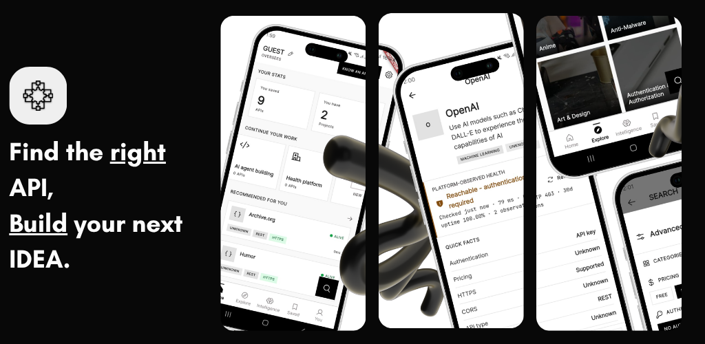
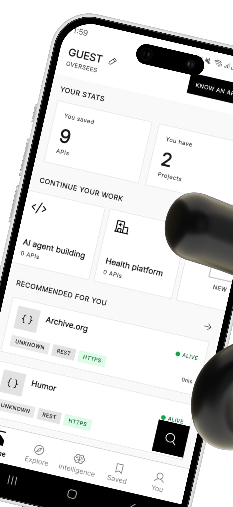
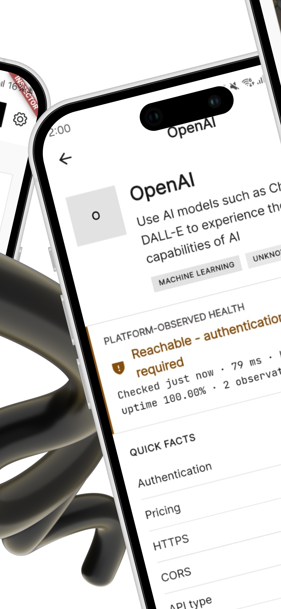
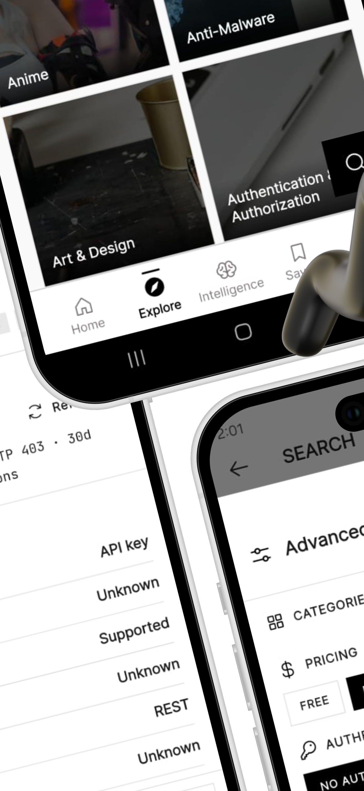

# Reqistry — APIs for You & AI

**Find the right API for your next build. Give your AI agent the same evidence.**

Discover thousands of public APIs, compare health and trust signals, and monitor the ones your projects depend on. Reqistry brings API research to your phone—and the same catalog to your AI coding agent through **MCP (Model Context Protocol)**.

[](https://play.google.com/store/apps/details?id=com.gwhyyy.publicApis&hl=en) [](https://docs.reqistry.dev/mcp/install) [](#development)

[Browse the catalog](https://reqistry.dev) · [Documentation](https://docs.reqistry.dev) · [Star this repo](https://github.com/reqistry/reqistry-app) · [Report an issue](https://github.com/reqistry/reqistry-app/issues)

**5K+ downloads on [Google Play](https://play.google.com/store/apps/details?id=com.gwhyyy.publicApis&hl=en)** as of October 2026. Free, ad-supported Android app. No subscription.

[](https://play.google.com/store/apps/details?id=com.gwhyyy.publicApis&hl=en)

## Features — discover, decide, and keep building

**Your API research, project stack, and monitoring in one place.** Go from “Which API should I use?” to a shortlist you can compare, save, and keep watching.

### Project management for your API stack

Give each build its own project: a finance dashboard, a travel app, or your next AI tool. Group its APIs together, keep favorites synced, and turn on project monitoring for a **daily health digest and health-history snapshots**. Pick up your research with the context already organized.

### Watchlists that bring changes to you

Follow keywords that matter to your work. Get push alerts when matching APIs are added or change, including pricing and trust updates. Watch a topic such as **weather**, **payments**, or **AI** while you focus on building.

### 24/7 API monitoring, even when the app is closed

Reqistry's hosted service runs scheduled health checks around the clock. Inspect observed availability, response times, and uptime history; enable alerts for saved APIs when health, pricing, or trust changes. The registry change feed puts changes across the catalog in one place.

Checks are periodic—roughly hourly according to the [monitoring documentation](https://docs.reqistry.dev/monitoring)—with verification timestamps on API profiles.

### Intelligence that helps you choose

Select **2–8 APIs inside the app** and compare trust, pricing, authentication, response time, 30-day uptime, rate limits, SDKs, and OpenAPI availability where recorded. Get an evidence-based **top pick**, see the fastest option and strongest uptime, and revisit recent comparisons without rebuilding your shortlist.

### AI-assisted API research through MCP

Bring Reqistry into Claude Code, Cursor, Codex, or another compatible AI client. Describe what you need, ask your agent to compare candidates, inspect their health evidence, and find alternatives using the hosted MCP tools. Manage agent keys from the app's Settings. [Connect your AI agent →](#built-for-developers-and-ai-agents)

**In-app AI-powered decisions are marked “coming soon” in the current codebase.** The available in-app Intelligence workflow is evidence-based comparison; natural-language AI interaction with the catalog currently runs through connected MCP clients.

### Curated collections: start with a ready-made shortlist

Open **Intelligence → Curated collections**, pick a job, and jump straight into comparison. Current presets include:

| Collection | What it helps you explore |
| --- | --- |
| **Build a finance dashboard** | Finance and cryptocurrency APIs for market data and financial tools. |
| **Best free AI APIs** | AI and machine-learning APIs with free or freemium access. |
| **APIs for travel apps** | Weather, travel, transportation, and geocoding APIs. |
| **No-auth APIs for prototypes** | Free APIs you can try without setting up an API key. |

### Submit your own API and reach other builders

Built an API—or found one worth sharing? **Submit it from the app for review**, then follow its review status under **My submissions**. Help developers and AI agents discover useful APIs through the same catalog.

### Discovery with the details that matter

Search thousands of APIs across AI, finance, weather, maps, security, games, and more. Filter by pricing, authentication, and CORS support, then inspect documentation and verification signals before adding an API to your stack.

Health and trust signals help you evaluate an API using available evidence. Check the verification timestamp and provider documentation when making an integration decision. [How trust scoring works →](https://docs.reqistry.dev/trust)

## See the Android app

Screenshots from the app's Google Play listing assets:

| Discover your next API | Inspect health and trust | Search and filter |
| :---: | :---: | :---: |
|  |  |  |

**[Get Reqistry on Google Play →](https://play.google.com/store/apps/details?id=com.gwhyyy.publicApis&hl=en)**

## Built for developers and AI agents

Your coding agent can research APIs using Reqistry's catalog and health evidence during your development session. Connect it through the hosted MCP server:

```text
https://mcp.reqistry.dev/mcp
```

Follow the [MCP installation guide](https://docs.reqistry.dev/mcp/install) for Claude Code, Cursor, OpenAI Codex, OpenCode, Windsurf, and other compatible clients. Public catalog discovery requires no account or API key; the app also provides agent-key management in Settings.

Once connected, try:

> Find a free weather API with no authentication. Check its health and CORS support.

> Compare APIs for sending transactional email, including pricing and authentication.

> Find alternatives to this API and show the evidence behind your shortlist.

### One catalog, wherever you build

| Use Reqistry through | Start here |
| --- | --- |
| **Android** — discover, save, and monitor on the go | [Google Play](https://play.google.com/store/apps/details?id=com.gwhyyy.publicApis&hl=en) |
| **Web** — browse and compare in your browser | [reqistry.dev](https://reqistry.dev) |
| **AI agents** — query the catalog through MCP | [Connect your agent](https://docs.reqistry.dev/mcp/install) |
| **REST API** — work with the catalog as JSON | [API reference](https://docs.reqistry.dev/api/overview) |

Try a public read from your terminal:

```bash
curl --fail --show-error https://api.reqistry.dev/v1/categories
```

This repository contains the **Flutter mobile app**. The web catalog, REST API, and MCP server are hosted Reqistry services.

## Help more builders find Reqistry

- **Star this repository** if Reqistry belongs in your developer toolkit.
- **Try the app and leave an honest review** on [Google Play](https://play.google.com/store/apps/details?id=com.gwhyyy.publicApis&hl=en).
- **Share it with your team** or a developer choosing APIs for their next project.
- **Grow the catalog** by submitting an API through Reqistry, or [report an app issue](https://github.com/reqistry/reqistry-app/issues).
- **Join the conversation** on [Product Hunt](https://www.producthunt.com/products/reqistry-find-the-right-api).

## Development

### Prerequisites

- Flutter stable with Dart. The checked-in [lockfile](pubspec.lock) requires **Flutter ≥3.44.0 and Dart ≥3.12.0**; dependency requirements are stricter than the package's declared Dart minimum.
- Android SDK, **JDK 17**, and an Android emulator or device.
- A matching Firebase configuration: `android/app/google-services.json` is required by the Android Google Services Gradle plugin. Coordinate with the maintainer for the official project; for your own Firebase project, configure both that file and `lib/firebase_options.dart` consistently.

### Run locally

```bash
git clone https://github.com/reqistry/reqistry-app.git
cd reqistry-app
flutter pub get
cp .env.example .env.prod
```

Edit `.env.prod` before generating configuration:

| Variable | Local setup |
| --- | --- |
| `API_BASE_URL` | `https://api.reqistry.dev` |
| `PRIVACY_MD_URL` | `https://api.reqistry.dev/static/privacy.md` |
| App name, description, contact, and public links | Review the defaults in [.env.example](.env.example). |
| `ADMOB_ANDROID_APP_ID` | For local development, use Google's sample app ID: `ca-app-pub-3940256099942544~3347511713`. Debug/profile Dart code selects test ad units automatically. |
| `POSTHOG_PROJECT_TOKEN` | Set to an empty value to disable local telemetry, or use your own project's token. |

Both Dart environment generation and Android Gradle configuration read **`.env.prod`**. After editing it:

```bash
dart run build_runner build --delete-conflicting-outputs
flutter gen-l10n
flutter run
```

Environment files and local signing files are gitignored. Generated `lib/config/env.g.dart` is currently tracked: review generated diffs and keep private credentials out of client configuration and commits.

### Quality checks

```bash
flutter analyze
flutter test
flutter gen-l10n
flutter build apk --debug
```

Release signing reads **`key.properties` at the repository root**, pointing to a local keystore. Production releases also need the appropriate Firebase and AdMob configuration.

### Code map

| Location | Responsibility |
| --- | --- |
| [`lib/app/modules/views/`](lib/app/modules/views/) | Screens and feature widgets |
| [`lib/app/blocs/`](lib/app/blocs/) | Cubit state management |
| [`lib/app/data/models/`](lib/app/data/models/) | API response models |
| [`lib/app/services/`](lib/app/services/) | Networking, authentication, notifications, ads, and analytics |
| [`lib/config/`](lib/config/) | Routes and environment configuration |
| [`lib/l10n/`](lib/l10n/) | English and Spanish localization |
| [`test/`](test/) | Automated tests |
| [`openapi.mobile.json`](openapi.mobile.json) | Mobile API contract |

Read [AGENTS.md](AGENTS.md) for repository conventions before making changes.

## Troubleshooting

| Problem | What to check |
| --- | --- |
| Dependency resolution fails | Run `flutter --version` and compare it with the SDK requirements above. |
| Missing `google-services.json` / `processDebugGoogleServices` fails | Add matching Firebase configuration to `android/app/`; the Gradle plugin requires it for debug builds too. |
| Missing or stale `env.g.dart` values | Fill in `.env.prod`, rerun `dart run build_runner build --delete-conflicting-outputs`, then rebuild the app. |
| Localization generation fails | Check the ARB syntax and matching keys in `lib/l10n/app_en.arb` and `lib/l10n/app_es.arb`, then run `flutter gen-l10n`. |
| Notifications do not arrive | Check Firebase configuration, device notification permission, and notification preferences. |
| `Missing release signing configuration` | Use a debug build for local development, or supply root-level `key.properties` and its referenced keystore for an authorized release. |

Still stuck? [Open an issue](https://github.com/reqistry/reqistry-app/issues) with reproduction steps, expected and actual behavior, app/Android versions, and screenshots. For build problems, include `flutter --version`, the failing command, and relevant logs with credentials removed.

## Feedback and contributions

Bug reports, feature ideas, accessibility feedback, and localization improvements are welcome. Search [existing issues](https://github.com/reqistry/reqistry-app/issues) first; discuss larger changes with the maintainer before implementation. For code contributions, review the licensing status below and run the quality checks above.

Built by [Gwhyyy](https://gwhyyy.com). Contact: [work@gwhyyy.com](mailto:work@gwhyyy.com). [Privacy policy](https://reqistry.dev/privacy).

## License

This repository does not currently include a `LICENSE` file. Public visibility alone does not grant an open-source license. Contact [work@gwhyyy.com](mailto:work@gwhyyy.com) to clarify permission to use, modify, or redistribute the code.
